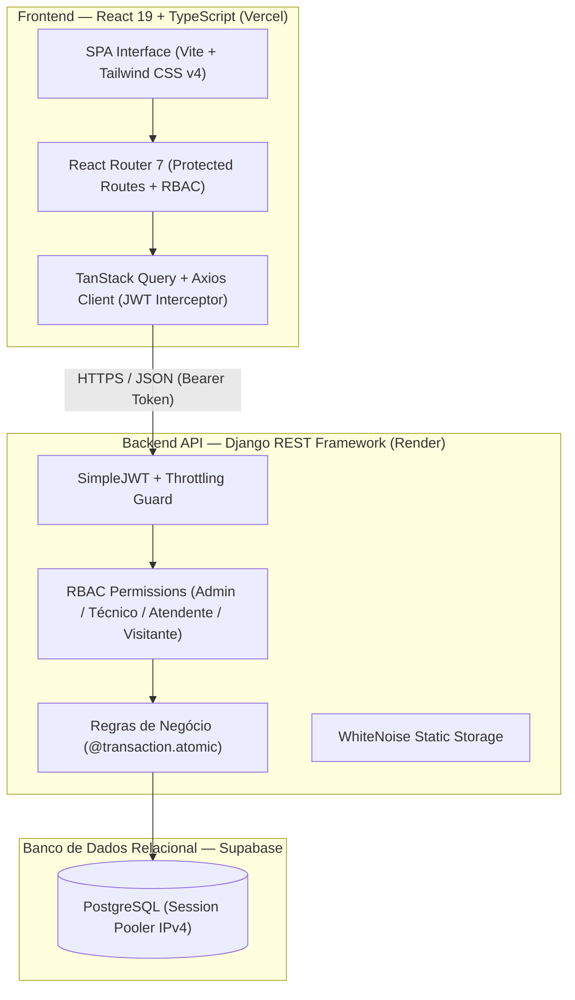

<div align="center">

  

  # O.S. & Estoque Pro
  ### Mini-ERP B2B para Gestão de Ordens de Serviço & Controle Atômico de Estoque

  <p align="center">
    Uma plataforma completa de assistência técnica e gestão operacional, construída com arquitetura resiliente, transações atômicas, segregação de permissões (RBAC) e conformidade com privacidade de dados (LGPD).
  </p>

  <p align="center">
    <a href="#-demonstração--credenciais-de-acesso">Demonstração</a> •
    <a href="#-principais-recursos--diferenciais">Diferenciais</a> •
    <a href="#-arquitetura--fluxo-de-dados">Arquitetura</a> •
    <a href="#-tecnologias-utilizadas">Stack</a> •
    <a href="#-segurança--auditoria">Segurança</a> •
    <a href="#-testes-automatizados">Testes</a> •
    <a href="#-estrutura-de-diretórios">Estrutura</a>
  </p>

  <p align="center">
    
    
    
    
    
    
    
  </p>

</div>

---

## 🎯 Sobre o Projeto

O **O.S. & Estoque Pro** foi concebido para resolver os gargalos reais de oficinas técnicas, assistências autorizadas e empresas de manutenção corporativa: descontrole de peças em bancada, divergência entre orçamentos e custos reais, falta de rastreabilidade nas etapas de reparo e ausência de relatórios em tempo real.

O sistema integra a abertura do chamado técnico à baixa física imediata no estoque, gerando laudos técnicos, linha do tempo auditável de alterações e visão consolidada de faturamento.

---

## 🚀 Demonstração & Credenciais de Acesso

O sistema dispõe de controle granular de acesso (**RBAC - Role-Based Access Control**) com 4 perfis distintos. Para fins de avaliação de recrutadores e demonstração técnica:

> 💡 **Acesso com 1 Clique (Modo Observação):** Na tela inicial de login, utilize o botão **"Explorar como Visitante"**. Ele inicia uma sessão segura de somente leitura com dados mascarados (LGPD).

| Perfil | Usuário | Senha | Permissões & Escopo |
| :--- | :--- | :--- | :--- |
| **Administrador** | `certa` | `Totinhasbanco1234@` | Acesso total: gestão financeira, equipe, exclusões e parametrizações |
| **Técnico** | `tecnico` | `Totinhastecnico1234@` | Execução de O.S., emissão de laudos técnicos e movimentação de estoque |
| **Atendente** | `atendente` | `Totinhasatendente1234@` | Cadastro de clientes, abertura de orçamentos e consulta de peças |
| **Visitante** | `visitante` | `visitante123` | **Modo Demonstração:** Leitura restrita, PII mascarado e mutações bloqueadas |

---

## ✨ Principais Recursos & Diferenciais de Engenharia

### 1. Integridade Atômica de Estoque (`@transaction.atomic`)
- **Baixa Inteligente:** Ao aprovar ou concluir uma O.S., os itens associados são debitados de forma atômica do saldo físico. Se qualquer item não possuir quantidade suficiente, a transação sofre *rollback* automático com mensagem de erro clara.
- **Prevenção de Estoque Órfão:** Cancelar uma O.S. estorna imediatamente todas as peças de volta ao inventário com registro no livro razão de movimentações. Excluir uma O.S. aprovada também aciona o estorno automático antes da deleção.
- **Auditoria de Movimentações:** Toda entrada, saída e ajuste gera registro imutável contendo operador responsável, saldo anterior, saldo posterior, data e justificativa.

### 2. Gestão Dinâmica de Ordens de Serviço
- **Linha do Tempo (Audit Trail):** Histórico completo de transições de status (`Orçamento` ➔ `Aprovado` ➔ `Em Andamento` ➔ `Concluído` ou `Cancelado`).
- **Validação Financeira em Tempo Real:** Cálculo dinâmico de serviços, peças aplicadas e trava contra descontos superiores ao valor bruto.
- **Emissão & Impressão:** Modal com layout para impressão imediata de vias para o cliente e para a bancada técnica.

### 3. Painel de Performance & KPIs Executivos
- Indicadores em tempo real: volume de chamados em aberto, receita represada em execução (R$), faturamento concluído e alertas de peças com saldo abaixo do estoque mínimo.
- Gráficos de funil de conversão com percentual de distribuição por status e cálculo do **Ticket Médio**.

### 4. Interface High-End (*Soft Structuralism & Double-Bezel*)
- Design projetado com a linguagem visual **Double-Bezel** (molduras concêntricas com brilho sutil interno e elevações suaves).
- Tipografia dual: **Plus Jakarta Sans** para leitura ergonômica e **JetBrains Mono** para dados numéricos, moedas e SKUs.
- Totalmente responsivo para tablets, celulares e telas ultra-wide.

---

## 🏛️ Arquitetura & Fluxo de Dados



---

## 🛠️ Tecnologias Utilizadas

### Frontend
* **Core:** React 19, TypeScript 7, Vite 8.
* **Estilização & Design:** Tailwind CSS v4, Lucide React Icons.
* **Roteamento & Estado:** React Router 7, TanStack Query (React Query v5).
* **Comunicação HTTP:** Axios com interceptors de autenticação e *auto-refresh* de tokens JWT.

### Backend
* **Core:** Python 3.12+, Django 6.1, Django REST Framework 3.18.
* **Autenticação:** SimpleJWT (Access Token 60min + Refresh Token 7 dias).
* **Segurança & CORS:** `django-cors-headers`, Rate Throttling, Security Headers.
* **Deploy & Servidor:** Gunicorn, WhiteNoise (armazenamento estático manifest comprimido).

### Banco de Dados & Infraestrutura
* **Banco:** PostgreSQL 16+ gerenciado no **Supabase** via Session Pooler.
* **Hospedagem Backend:** **Render** (com especificação de infraestrutura em `render.yaml`).
* **Hospedagem Frontend:** **Vercel** (com regras de reescrita SPA em `vercel.json`).

---

## 🔒 Segurança, Hardening & Conformidade (LGPD)

O projeto passou por rigorosa auditoria de segurança com base no *OWASP Top 10 API Security*:

* **Prevenção de Escalação de Privilégios (*Mass Assignment*):** O endpoint de perfil do usuário (`/api/auth/me/`) possui serializer estrito com campos como `cargo`, `is_staff` e `is_superuser` marcados como estritamente de leitura.
* **Mascaramento de Dados Sensíveis (LGPD):** Quando o sistema é consultado com o perfil de `VISITANTE`, números de CPF/CNPJ (`***.***.***-**`) e telefones (`(**) *****-****`) são automaticamente mascarados pela camada de representação de dados da API.
* **Proteção contra Força Bruta (Throttling):** Limitação de tentativas de login (`15 requisições/minuto` por IP) via `ScopedRateThrottle`.
* **Proteção contra Auto-Lockout:** Administradores são impedidos pela API de excluir a própria conta ativa.
* **Cabeçalhos HTTP Hardened:** `X-Frame-Options: DENY`, `SECURE_CONTENT_TYPE_NOSNIFF`, políticas restritas de *referrer* e cookies `HttpOnly`/`SameSite`.

---

## 🧪 Testes Automatizados

A aplicação conta com uma suíte de **23 testes automatizados** cobrindo autenticação, controle de acesso (RBAC), operações atômicas de estoque e segurança contra intrusão.

Para executar os testes:
```bash
cd backend
python manage.py test --verbosity=2
```

**Resultado dos Testes:**
```text
Found 23 test(s).
test_atualizar_e_excluir_cliente_rbac ... ok
test_bloqueio_cpf_cnpj_duplicado ... ok
test_seguranca_visitante_bloqueado_em_clientes_mas_le_servicos ... ok
test_criar_produto_gera_movimentacao_inicial ... ok
test_movimentacao_entrada_saida_ajuste_e_bloqueio_saldo ... ok
test_seguranca_visitante_e_atendente_no_estoque ... ok
test_fluxo_completo_os_orcamento_aprovacao_conclusao_e_cancelamento ... ok
test_bloqueia_aprovacao_sem_estoque_suficiente ... ok
test_seguranca_mascaramento_pii_visitante_e_bloqueio_escrita ... ok
test_seguranca_validacao_desconto_excessivo_e_estorno_ao_deletar ... ok
test_seguranca_bloqueio_escalacao_privilegio_mass_assignment ... ok
test_seguranca_admin_nao_pode_excluir_propria_conta ... ok
...
Ran 23 tests in 12.0s - OK
```

---

## 📁 Estrutura de Diretórios

```text
os-estoque-pro/
├── backend/                  # API REST em Django
│   ├── cadastros/            # Clientes e Catálogo de Serviços
│   ├── estoque/              # Categorias, Produtos e Movimentações
│   ├── ordens_servico/       # Ordens de Serviço, Laudos e Histórico
│   ├── usuarios/             # Custom User, JWT, RBAC e Permissões
│   ├── core/                 # Settings, URLs, WSGI e WhiteNoise
│   ├── build.sh              # Script de automação de build para o Render
│   └── requirements.txt      # Dependências Python
├── frontend/                 # Aplicação SPA em React 19 + TypeScript
│   ├── src/
│   │   ├── api/              # Cliente Axios com interceptors de JWT
│   │   ├── components/       # Layout, ProtectedRoute e componentes reutilizáveis
│   │   ├── context/          # Contexto de autenticação global
│   │   ├── pages/            # Telas (Dashboard, O.S., Estoque, Clientes, etc.)
│   │   └── types/            # Tipagens TypeScript do sistema
│   ├── public/               # Favicon vetorial e manifest
│   └── vercel.json           # Configuração de rewrites SPA para a Vercel
├── render.yaml               # Infraestrutura como Código (Blueprint Render)
├── LICENSE                   # Licença MIT
├── .gitignore                # Regras de proteção de credenciais e caches
└── README.md                 # Documentação principal de apresentação
```

---

## 📄 Licença

Distribuído sob a licença **MIT**. Veja `LICENSE` para mais informações.

---

<div align="center">
  Desenvolvido com foco em arquitetura limpa, segurança e alta performance.
</div>

